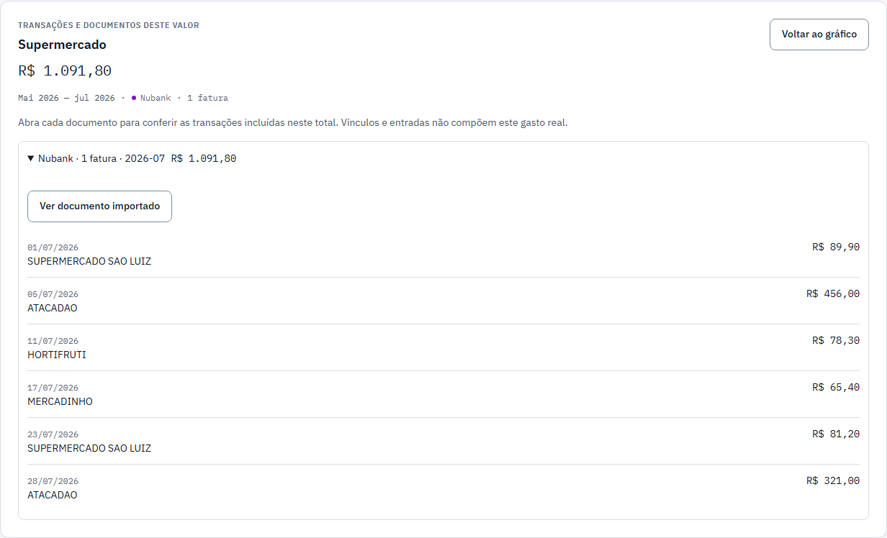
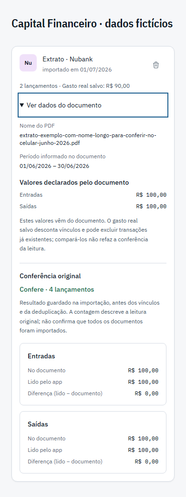

# Origem dos valores — entrega e provas

Data: 17/10/2026. Branch: `codex/origem-dos-valores`.
Código em `9375e11`; [PR #34](https://github.com/cielioqueiroz/controle-financeiro/pull/34)
registra os checks remotos e a integração.

## O que mudou

1. Relatórios mantém o detalhe selecionado na URL. Cada grupo de transações
   oferece **Ver documento importado**, em vez de exibir somente um ID técnico.
2. Faturas abre os dados do documento correspondente e foca seu resumo. Nome,
   período, gabaritos e conferência original ficam visíveis.
3. Voltar pelo navegador restaura o detalhe com banco, período e janela. Fechar
   restaura foco ao gatilho ou ao título do relatório após remontagem.
4. Documento indisponível tem mensagem própria e ação para limpar a seleção,
   preservando filtros. Consulta lenta ou falha não vira documento ausente.

Não armazena nem abre o PDF original. Não acrescenta gravação no banco,
dependência ou regra de cálculo financeiro.

## Provas

- Testes relacionados: **5 arquivos, 32 testes aprovados**. Cobrem URL direta,
  seleção inválida, carregamento, ausência, erro/retry, foco e navegação integrada
  Relatórios → Faturas → Voltar, com conferência original visível.
- `npm run verificar`: seis passos aprovados: tipos (25,8 s), testes
  (276,1 s), lint (1,2 s), caminhos (0,4 s), build (34,8 s) e CSP (11,4 s).
- Overflow e axe-core: **28 jornadas em 1280×800 e 390×844**, sem rolagem lateral
  e sem violações critical/serious. Incluem seleção/foco automáticos, ausência
  e ação de origem. Nenhuma cor foi alterada nesta rodada.
- Revisão independente final: nenhum achado crítico ou importante. Código de
  produção considerado apto a integrar após aprovação dos gates.

## Prévias com dados fictícios

As prévias usam os mesmos componentes do produto. Reprodução local:

- `/demo.html?tela=relatorios&janela=3&tema=claro`: escolher Supermercado e
  expandir um grupo de documento.
- `/demo.html?tela=documentos&amostra=confere&documento=documento-ficticio&tema=claro`.
- `/demo.html?tela=documentos&documento=ausente`.

## Decisões de execução

- A seleção de relatório permanece na página: três parâmetros/guardas não
  justificam um helper separado. Se crescer, extrair apresentação, sem mover
  esse estado para domínio financeiro.
- A autorização integral posterior do usuário cobre finalizar e publicar após
  revisão e gates; substitui a restrição anterior de deixar esta rodada local.
- Git Bash exigiu permissão do ambiente para gerar os resumos de execução.
- Testes específicos usam `npm run test --workspace frontend -- src/...`;
  os filtros são relativos ao workspace. O comando inicial com `frontend/src`
  não encontrou testes, e não foi usado como evidência de aprovação.
- O plano descreve critérios verificáveis; comandos foram escolhidos para
  comprová-los, com resultados lidos. Testes e ledger registrados nesta sessão.
- Revisão de código e gates independentes executados em paralelo; publicação
  continua condicionada à aprovação de ambos.

## Achado menor adiado

A demo isolada prova a presença da ação e a seleção automática em jornadas
separadas. Seu botão de origem ainda não troca entre as duas prévias, pois o
seletor lê a URL da janela e a navegação usa MemoryRouter, com IDs fictícios
distintos. O caminho real entre páginas foi aprovado no teste integrado com
Routes. Limitação da demo aceita como não bloqueante, registrada para correção
posterior; os prints acima não são uma prova de navegação entre as telas.

O revisor não julgou gates em execução nem o Neon/RLS do PR33. Os gates são
conferidos pelo executor; a rodada não altera o adaptador/RLS já exercitado
contra a branch Neon real. Nenhuma verificação pendente é presumida aprovada.

## Limites

OAuth, entrega de e-mail e PDFs pessoais de bancos continuam com roteiro manual
próprio. Os parsers e o fluxo de autenticação não foram alterados nesta rodada.
